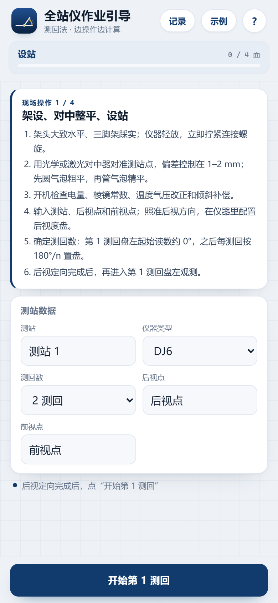
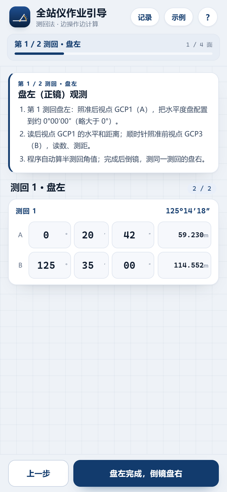
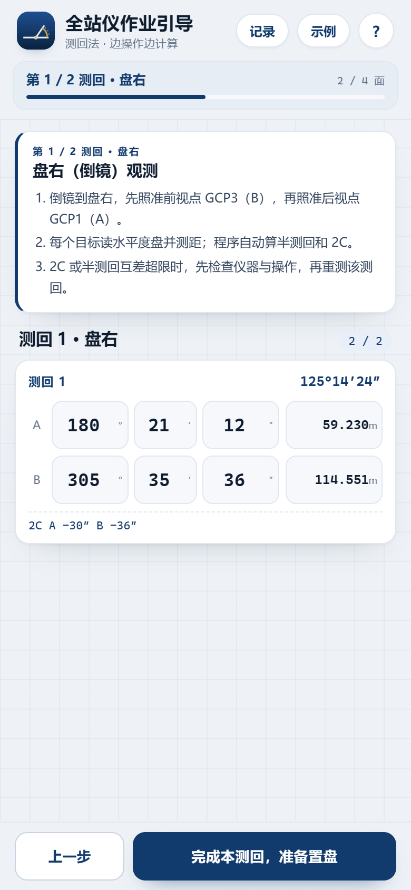
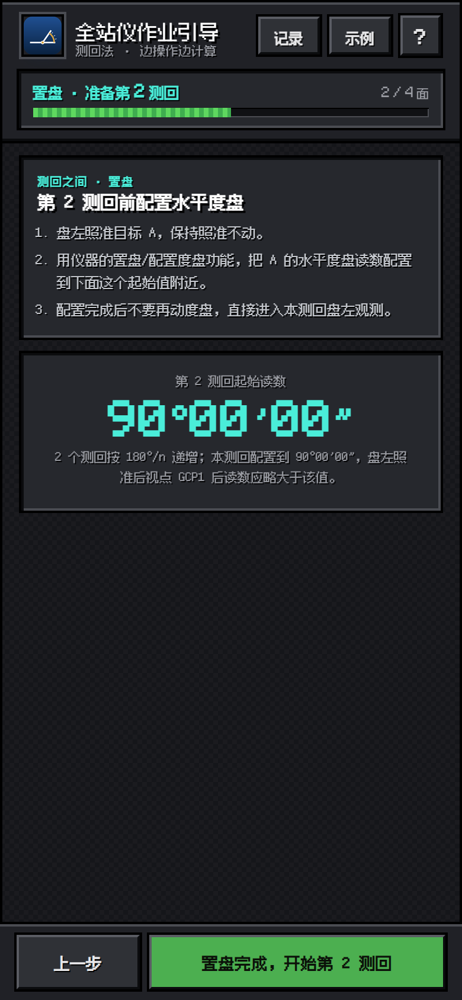
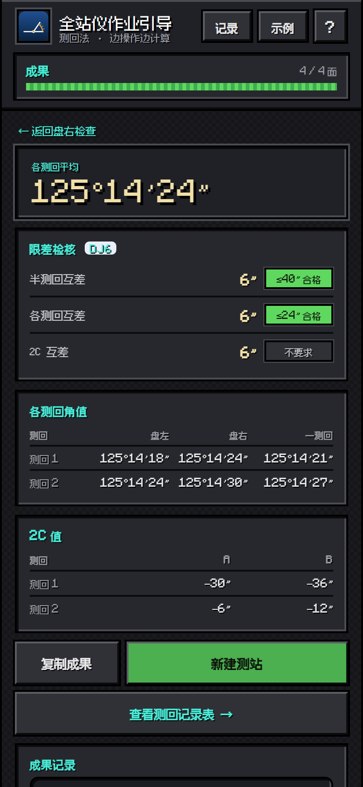

# 全站仪作业引导 · 测回法

手机端 PWA：按现场顺序引导你完成 **设站 → 第 1 测回盘左 → 同测回盘右 → 置盘 → 第 2 测回 → 成果**，边输入读数边自动计算半测回角值、2C、一测回角值、各测回平均和限差。它是原「测回计算器」之外的新项目，原简单计算器保持不动。

[](https://github.com/Prqingyu/total-station-guide/actions/workflows/test.yml)
[](LICENSE)

**在线使用：<https://prqingyu.github.io/total-station-guide/>**

原简单计算器：<https://prqingyu.github.io/total-station-calc/>（未覆盖）

<p>
  
  
  
  
  
</p>

## 引导流程

一个测回 = **一个盘左半测回 + 一个盘右半测回**，不能连着测两个盘左；每测回结束后再置盘，进入下一测回。

1. **设站**：架设、对中（≤1–2 mm）、整平、开机检查；输入测站名称、仪器类型、**测回数（1–4，默认 2）**和后视点。
2. **第 1 测回盘左**：照准目标 A，把水平度盘配置到约 0°00′00″；读 A、B 水平角和距离，自动算半测回角值。
3. **同测回盘右**：倒镜，先 B 后 A；读数、测距，自动算半测回和 2C。
4. **置盘**：第 2 测回开始前，盘左照准 A，把水平度盘配置到约 **90°00′00″**（n 个测回按 180°/n 递增）。
5. **第 2 测回**：再按盘左 → 盘右测一个完整测回。
6. **成果**：各测回平均角、各测回角值、2C 值、水平距离、限差检核、成果记录；可复制成果或新建测站。

## 置盘规则

| 测回数 | 各测回盘左起始读数 |
| --- | --- |
| 2 | 0°、90° |
| 3 | 0°、60°、120° |
| 4 | 0°、45°、90°、135° |

不同测回间配置度盘，是为了减小度盘刻划误差；盘右观测已经用到度盘的另一半，所以按 180°/n 递增，而不是 360°/n。

## 自动计算

```
半测回：β_L = b_L − a_L，β_R = b_R − a_R（负值 +360°）
一测回：β = (β_L + β_R) / 2
各测回平均：Σβ / n
2C = L − (R ± 180°)
2C 互差 = 同一测回内各方向 2C 的最大值 − 最小值（多测回取最大）
水平距离 = 同一目标在各盘、各测回的距离平均
```

## 限差

| 项目 | DJ6 | DJ2 |
| --- | --- | --- |
| 半测回角值互差 | 40″ | 20″ |
| 各测回角值互差 | 24″ | 12″ |
| 2C 互差 | 不作要求 | 13″ |

限差随规范版本、等级和仪器精度变化；程序按上表给出提示，实际以现行规范（如 GB 50026-2020）和指导教师要求为准。DJ2 的半测回/各测回互差在不同教材中有 12″/20″、9″/12″ 等取值，本程序采用较常用的一组。

## 参考流程与公式

- [方向测回法步骤与限差（赛维板报）](https://m.sohu.com/a/895039123_120680207/)
- [长安大学《角度测量》讲义](https://celiang.chd.edu.cn/_mediafile/zerui51/2013/10/30/1kiob2sk2x.pdf)
- [中国矿业大学 竖直角与指标差实验](https://labch.cumt.edu.cn/_upload/article/files/f5/24/d1cf03c04137a3cbb58f82d47e81/aac73c8e-556b-43c7-af02-0c1f28013915.pdf)
- [拓普康全站仪操作手册](https://topconchina.cn/upload/newsfile/202010/1602160664jh8bagfb.pdf)
- [全站仪操作步骤（天津达光）](http://www.tjdgch.com/hangye/122.html)
- 课程讲义《角度测量》（Chapter4_2，测回法与 180°/n 配度盘）

## 安装与离线

- **Android**：Chrome 打开在线地址 → 菜单 →「添加到主屏幕」。
- **iPhone**：Safari 打开 → 分享 →「添加到主屏幕」。

首次打开后由 Service Worker 缓存，断网也能继续记录；数据保存在本机 `localStorage`。

## 本地运行与测试

```bash
npm install
npm test             # 计算核心单元测试（含 2C）
npm run serve        # http://127.0.0.1:8788/
node tests/e2e.mjs   # 无头 Edge 端到端测试（56 项）
node tests/pwa.mjs   # 线上 PWA / 离线测试
node tools/screenshots.mjs
```

E2E 需要本机安装 Microsoft Edge；可用 `EDGE_PATH` 指定浏览器路径，用 `BASE_URL` 指向线上地址。

## 文件结构

```
index.html            四步引导、成果页、键盘
style.css             移动端样式（深色模式、固定步骤按钮、键盘）
app.js                步骤状态、读数录入、2C/限差、成果记录
calc.js               纯计算核心（角度、距离、2C、修约）
sw.js                 Service Worker（离线缓存）
manifest.webmanifest  PWA 清单
tests/                单元测试、E2E、PWA 测试
tools/                本地服务器与截图
docs/                 README 截图
```

## License

MIT，见 [LICENSE](LICENSE)。原「测回计算器」项目同样为 MIT，本引导版从它派生，但独立部署、独立维护。
